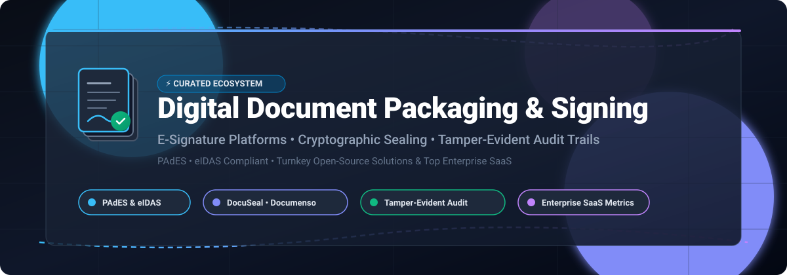

  

# 📑 Awesome Digital Document Packaging & Signing 

> 🚀 A curated list of exceptional SaaS platforms, open-source e-signature engines, and cryptographic PDF packaging tools with tamper-evident audit trails and PAdES/eIDAS compliance.

  
  
  
  
  

Digital document packaging and signing technologies enable organizations to prepare, dispatch, and execute legally binding electronic agreements. This ecosystem encompasses visual envelope and drag-and-drop field builders, multi-party signing order, signer identity verification, cryptographic digital signature sealing (such as PAdES, XAdES, CAdES), and tamper-evident audit trails.

---

## 📌 Table of Contents

- [📊 Sector Overview & Market Dynamics](#-sector-overview--market-dynamics)
- [☁️ SaaS / Hosted Platforms](#️-saas--hosted-platforms)
- [💻 Open-Source GitHub Projects](#-open-source-github-projects)
  - [📦 Turnkey E-Signature Applications](#-turnkey-e-signature-applications)
  - [🔐 Cryptographic Libraries & Signing Utilities](#-cryptographic-libraries--signing-utilities)
- [🧭 Developer & Architectural Selection Guide](#-developer--architectural-selection-guide)
- [🤝 How to Contribute](#-how-to-contribute)
- [⭐ Star History](#-star-history)
- [💖 Support](#-support)
- [⚖️ Disclaimer & Legal Notes](#️-disclaimer--legal-notes)

---

## 📊 Sector Overview & Market Dynamics

The global digital signature and e-signature market is valued between **$8.5 billion and $17.5 billion**, expanding at an aggressive Compound Annual Growth Rate (CAGR) of **22% to 35%** into the 2030s. Structurally, the sector has transitioned from a highly concentrated monopoly dominated by DocuSign and Adobe Acrobat Sign into a **moderately fragmented** ecosystem, driven by unbundling, open-source self-hosted alternatives, API-first embedding, and regional Qualified Trust Service Provider (QTSP) compliance mandates (such as eIDAS 2.0 in the EU).

---

## ☁️ SaaS / Hosted Platforms

*Commercial e-signature and document packaging platforms sorted by company scale (market capitalization / valuation in descending order).*

| 🏢 Product | 📈 Scale (Valuation / Revenue) | 💳 Starting Pricing Tier | 🎁 Free Tier / Trial Limits | 📝 Description |
|---|---|---|---|---|
| **[Adobe Acrobat Sign](https://www.adobe.com/sign.html)** | **~$93 Billion** Market Cap (~$26B Revenue) | **$14.99/month** (Acrobat Standard, single user) or **$23.99/user/month** (Teams, billed annually) | **30-day free trial** with standard testing allowances; no permanent free sending tier (150 transactions/user/year cap on standard plans; upfront disclosure of termination fees) | Enterprise-grade document cloud integrating PDF editing, envelope workflows, and legally binding e-signatures. Bundled into Acrobat subscription tiers. |
| **[DocuSign](https://www.docusign.com/)** | **~$15 Billion** Market Cap (~$3.36B Revenue) | **$10/month** (Personal plan, billed annually; 5 envelopes/month cap) or **$25/user/month** (Standard plan) | **30-day free trial** (capped at 5 envelope sends total, max 5 recipients/envelope); standard free account allows unlimited signing but **0 sends** | The market-share category leader in electronic signature and Intelligent Agreement Management (IAM), featuring advanced recipient authentication, custom envelope templates, and completion certificates. |
| **[Dropbox Sign](https://sign.dropbox.com/)** | **~$7.2 Billion** Market Cap (~$2.53B Revenue) | **$15/month** (Essentials plan, 1 user, billed annually at $180/year) | **Free plan: 3 signature requests per month** (renews every 30 days; self-signing is unlimited); 30-day free trial for paid plans | Formerly HelloSign; developer-friendly signature platform offering **unlimited signature requests** on paid plans without per-envelope surprise overages. |
| **[signNow](https://www.signnow.com/)** | **~$1.25 Billion** Valuation (airSlate parent; ~$200M ARR, ~$35M signNow) | **$8/user/month** (Business plan, billed annually at $96/year) or **$15/user/month** (Business Premium) | **7-day free trial** with full feature evaluation (standard paid plans allocate 100 signature invites/user/year); no permanent free sending tier | Cost-effective cloud e-signature platform built under airSlate, providing visual field assignment, reusable templates, automated team reminders, and mobile signing. |
| **[PandaDoc](https://www.pandadoc.com/)** | **~$1.0 Billion** Valuation (~$100M ARR) | **$19/user/month** (Starter plan, billed annually) or **$49/user/month** (Business plan) | **Free eSign plan: 5 documents/month**, 2 recipients/document, 5 templates; **14-day free trial** for Business tier with up to 50 documents | Document automation and CPQ platform streamlining document generation, interactive quote proposals, payment capture, and digital signing in one canvas. |
| **[OneSpan Sign](https://www.onespan.com/)** | **~$850 Million** Market Cap (~$243M Revenue) | **$20/user/month** (Professional plan, billed annually) or custom volume transaction pricing | **30-day free trial** with full platform capabilities; **permanently free unlimited developer sandbox** (watermarked/non-production test transactions) | High-assurance digital signature platform focused on regulated banking, healthcare, and enterprise environments requiring strict audit integrity and white-labeling. |

---

## 💻 Open-Source GitHub Projects

*Open-source self-hosted e-signature platforms, signing servers, and cryptographic libraries sorted by GitHub stargazer count (descending).*

### 📦 Turnkey E-Signature Applications

| 🚀 Project | ⭐ Stars | 📜 License | 🛠️ Tech Stack | 🔍 Key Capabilities |
|---|---|---|---|---|
| **[DocuSeal](https://github.com/docusealco/docuseal)** |  | AGPL-3.0 | Ruby on Rails 7, PostgreSQL, MinIO | Leading turnkey open-source DocuSign alternative. Features intuitive PDF drag-and-drop form builders, embeddable JS/React signing widgets, automated email/SMS reminders, unlimited envelopes/users in Community Edition, and tamper-evident audit certificates (~250 MB RAM footprint). |
| **[Documenso](https://github.com/documenso/documenso)** |  | AGPL-3.0 | TypeScript, Next.js, Prisma, Tailwind | Modern "Stripe for Signatures" web platform. Supports sequential and parallel signing orders, passkey/WebAuthn signing authentication, SHA-256 cryptographic audit logs, and embeddable React components via full REST API. |
| **[OpenSign](https://github.com/OpenSignLabs/OpenSign)** |  | AGPL-3.0 (with carve-outs) | Node.js, Express, MongoDB, React | Free & open-source agreement management platform offering cryptographic signing, IP-tracked audit trails, PDF completion certificates, multi-tenant workspace drive management, and comprehensive REST APIs. |
| **[LibreSign](https://github.com/LibreSign/libresign)** |  | AGPL-3.0 | PHP, Vue.js, Nextcloud | Fully integrated e-signature suite for Nextcloud deployments. Ideal for organizations seeking self-hosted private cloud storage with native in-place document signing without external cloud dependencies. |
| **[Penpact](https://github.com/penpact/penpact)** |  | AGPL-3.0 | TypeScript, React, Node.js | Developer-first embedded e-signature framework (early v0.1.0 development). Features AI field detection, themeable React client SDK (`@penpact/sdk`), append-only audit trail with IP/timestamps, PAdES digital signature sealing, and HMAC webhook dispatching. |

### 🔐 Cryptographic Libraries & Signing Utilities

| 🛠️ Project | ⭐ Stars | 📜 License | 🖥️ Language / Runtime | 🎯 Focus & Architecture |
|---|---|---|---|---|
| **[esig/dss](https://github.com/esig/dss)** |  | LGPL-2.1 | Java | European Commission Digital Signature Service (DSS). Definitive reference implementation for creating, extending, and validating advanced & qualified electronic signatures compliant with eIDAS (PAdES, CAdES, XAdES, ASiC). |
| **[open-pdf-sign](https://github.com/open-pdf-sign/open-pdf-sign)** |  | Apache-2.0 | Java / CLI | Lightweight standalone command-line application and server to digitally sign PDF files with X.509 certificates, hardware security modules (HSM via PKCS#11), smart cards, and RFC 3161 timestamps. |
| **[node-signpdf](https://github.com/vbuch/node-signpdf)** |  | MIT | Node.js / JavaScript | Simple, dependency-light library for injecting cryptographic byte-range signatures into PDF files natively in Node.js environments. |
| **[pyHanko](https://github.com/MatthiasValvekens/pyHanko)** |  | MIT | Python | Advanced Python library and CLI tool for digital PDF signatures and document timestamping. Native support for PAdES-B-B, PAdES-B-T, and PAdES-B-LTA profiles, cryptographic hardware tokens (PKCS#11), and Long-Term Validation (LTV). |
| **[Keyfactor SignServer CE](https://github.com/Keyfactor/signserver-ce)** |  | LGPL-2.1 | Java | Enterprise PKI signing server facilitating centralized, automated cryptographic signing of documents (PDF, XML, Office), code signing, and server-side digital timestamping. |
| **[digitorus/pdfsign](https://github.com/digitorus/pdfsign)** |  | BSD-2-Clause | Go | Pure Go library to add and verify Advanced Electronic Signatures (AES) and Qualified Electronic Signatures (QES) inside PDF files, supporting PKCS#7/CMS signatures, visual signature appearances, and timestamp authorities. |

---

## 🧭 Developer & Architectural Selection Guide

- **Turnkey Self-Hosted Web Apps**:
  - Deploy **[DocuSeal](https://github.com/docusealco/docuseal)** for the fastest Docker-compose setup, lowest memory overhead (~250 MB), and unlimited envelopes/users.
  - Deploy **[Documenso](https://github.com/documenso/documenso)** if your engineering stack is TypeScript/Next.js and you require passkey-based signature authentication.
  - Deploy **[OpenSign](https://github.com/OpenSignLabs/OpenSign)** for Node.js/MongoDB environments wanting fine-grained IP tracking audit trails.
- **Embedded Signing & APIs**:
  - Integrate **[Dropbox Sign](https://sign.dropbox.com/)** or **[DocuSeal Pro](https://www.docuseal.com/)** for mature drop-in web components without per-seat surprises.
  - Explore **[Penpact](https://github.com/penpact/penpact)** for early-stage prototype development with AI-suggested field positioning.
- **Cryptographic PDF Sealing & eIDAS / PAdES Compliance**:
  - Use **[esig/dss](https://github.com/esig/dss)** (Java) for European eIDAS QES/AES compliance.
  - Use **[pyHanko](https://github.com/MatthiasValvekens/pyHanko)** (Python) for automated PAdES-LTA long-term validation and timestamping pipelines.
  - Use **[open-pdf-sign](https://github.com/open-pdf-sign/open-pdf-sign)** or **[node-signpdf](https://github.com/vbuch/node-signpdf)** for automated backend document stamping and CI/CD pipelines.

---

## 🤝 How to Contribute

1. Fork the repository.
2. Add your SaaS product or open-source repository following the table format.
3. Ensure you provide:
   - For SaaS: starting tier pricing, free tier/trial limits, company scale, and accurate descriptions.
   - For Open Source: valid GitHub URL, Stargazer badge (`style=social&color=white`) linked to the stargazer page, SPDX license, tech stack, and architectural summary.
4. Verify alphabetical or metric sorting where applicable.
5. Submit a Pull Request with a clear description of changes.

---

## ⭐ Star History

---

## 💖 Support

If you find this curated ecosystem list helpful, please consider showing your support:

- ⭐ **Star this repository** to help others discover it!
- 🍴 **Fork and contribute** to keep entries accurate and up to date.
- 📢 **Share** with colleagues, developers, and legal tech enthusiasts.
- ☕ **Buy me a coffee / Sponsor**: Support ongoing maintenance on the [GitHub Sponsor Dashboard](https://github.com/sponsors/ishandutta2007).

---

## ⚖️ Disclaimer & Legal Notes

- This repository is a community-curated educational resource and does not constitute formal legal counsel.
- Electronic signatures are governed by legal frameworks such as the **United States ESIGN Act (15 U.S.C. ch. 96)**, **UETA**, and the **European Union eIDAS Regulation (Regulation (EU) No 910/2014)**.
- Cryptographic integrity, non-repudiation, tamper evidence, and secure audit trail preservation are critical requirements. When implementing self-hosted solutions, verify X.509 certificate trust anchors, PDF byte-range cryptographic seals, and timestamp authority (TSA) configurations.

---

  Maintained with ❤️ by the open-source community. Star this repository to keep track of developments in digital document packaging and cryptographic signing!

